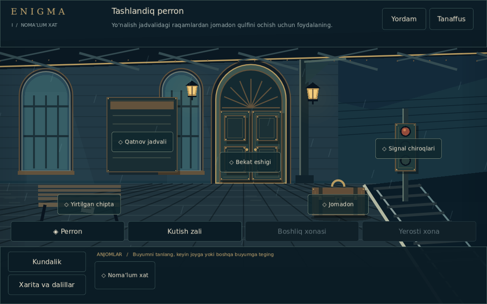

# ENIGMA — Unutilgan olam

Godot 4.6.3 uchun o‘zbek tilidagi, oflayn sirli sarguzasht. **v0.2 — birinchi bob.**

Qoratepa bekatiga noma’lum xat yetaklaydi. Jomadon, soatlar va hali qurimagan siyoh o‘zaro bog‘liq. To‘rtta joyni tekshiring, to‘qqiz jumboqni yeching va haydovchisiz poyezdni chaqiring.



## Telefon uchun APK

[APK olish va o‘rnatish tartibi](BUILD_INSTRUCTIONS.md). `Android APK` GitHub Actions jarayoni APKni qayta yig‘adi. Debug APK sinash uchun; Google Play relizi emas. Haqiqiy Android qurilma sinovi hali bajarilmagan.

## Ishga tushirish

Godot 4.6.3 da `project.godot` ni ochib Run bosing yoki `godot --path .` buyrug‘ini ishlating. Sahna va interfeys avtomatik yaratiladi; tugunlarni qo‘lda yig‘ish shart emas.

Cloud muhitda yozish mumkin bo‘lgan kataloglardan foydalaning:

```sh
cd /workspace/enigma
export XDG_DATA_HOME=/workspace/.local/share
export XDG_CONFIG_HOME=/workspace/.local/config
export XDG_CACHE_HOME=/workspace/.local/cache
godot --path .
```

Tekshiruvlar: `bash tools/test.sh`. Boshqaruv: joyga teging; buyumni tanlab, so‘ng boshqa buyumga yoki kerakli joyga teging. Kompyuterda sudrab qo‘yish ham qo‘llanadi. Kundalik topilgan ishoralarni saqlaydi. Yordam uch bosqichli va bepul.

## Hujjatlar

- [Haqiqiy rivojlanish holati](DEVELOPMENT_STATUS.md)
- [Texnik arxitektura, sahnalar, resurs va mobil strategiya](docs/ARCHITECTURE.md)
- [Bosqichma-bosqich yo‘l xaritasi](docs/ROADMAP.md)
- [Yetti bob va 56 jumboq loyihasi](data/chapters.json)
- [To‘liq buyurtma](docs/MASTER_SPECIFICATION.md)
- [Shaxsiy yashirin xat sozlamalari](data/personalized.json)

II–VII boblar, 47 qo‘shimcha jumboq va uch yakun hali yaratilmagan. Birinchi bob — to‘liq o‘yinning qisqa ishlaydigan bo‘lagi; 8–12 soatlik yakuniy mahsulot emas. Asl protseduraviy chizmalar va sintezlangan audio hozirgi uslubni ko‘rsatadi; tijoriy reliz uchun keyingi san’at, ovoz va qurilma QA ishlari zarur.

Godot MIT litsenziyasi va DejaVu shrift litsenziyasi o‘yindagi Mualliflar → Litsenziyalar bo‘limida mavjud. Asl o‘yin kodi va resurslari uchun ochiq manbali loyiha litsenziyasi hozircha tanlanmagan.
